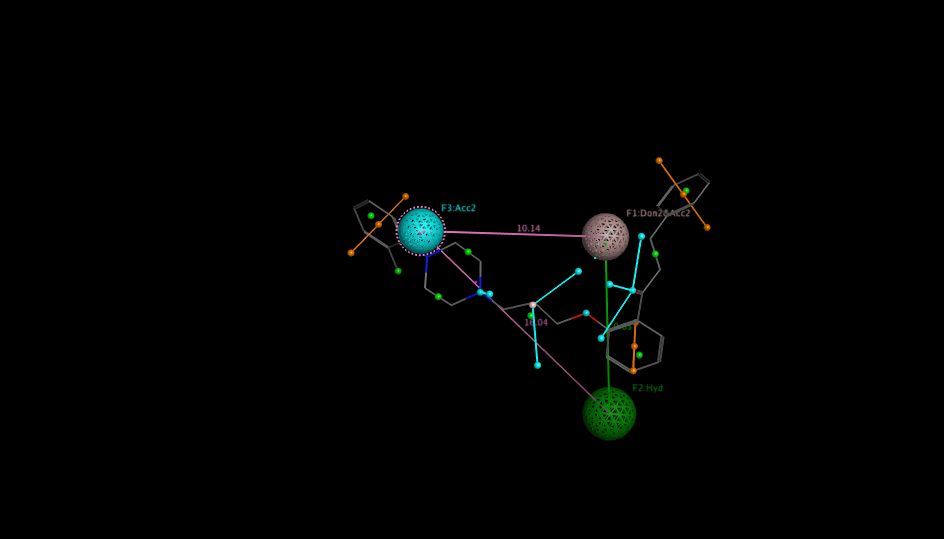
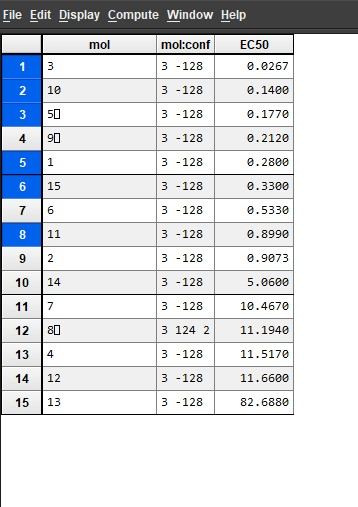
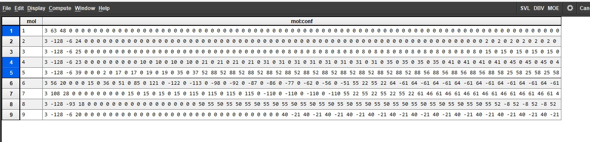

````markdown
<div align="center">

# hERG Pharmacophore Modeling using MOE

### MOE-based pharmacophore modeling workflow for hERG liability screening and computational drug-discovery portfolio demonstration

<br>


<br>

<a href="#project-overview">Overview</a> •
<a href="#workflow-summary">Workflow</a> •
<a href="#visual-results">Visual Results</a> •
<a href="#key-results">Key Results</a> •
<a href="#repository-structure">Repository</a> •
<a href="#author">Author</a>

</div>

---

## Project Overview

This repository presents a structured **MOE-based pharmacophore modeling workflow** for evaluating potential **hERG inhibitor liability** using small-molecule conformer databases, pharmacophore feature selection, virtual screening, hit inspection, and model-performance interpretation.

The project is organized as a clean **computational drug-discovery portfolio example**. It focuses on the practical steps used in **Molecular Operating Environment (MOE)** for pharmacophore model construction and virtual screening.

---

## Why This Project Matters

The **hERG potassium channel** is an important safety-related target in drug discovery because unwanted hERG inhibition may be associated with cardiotoxicity risk.

Early computational screening can help researchers identify compounds with possible hERG-related activity patterns before expensive downstream experimental testing.

This project demonstrates a practical cheminformatics workflow for:

- Building a pharmacophore model in MOE
- Preparing conformer databases
- Screening molecules against selected pharmacophore features
- Inspecting pharmacophore-matched hits
- Summarizing model performance using confusion-matrix metrics
- Organizing MOE-generated outputs in a clean portfolio-style repository

---

## Workflow Summary

```mermaid
flowchart LR
    A[Small Molecule Dataset] --> B[Conformer Database Preparation]
    B --> C[Pharmacophore Feature Selection]
    C --> D[MOE Pharmacophore Model]
    D --> E[Virtual Screening]
    E --> F[Hit Inspection]
    F --> G[Model Evaluation]
````

---

## Main Tasks

| Step                          | Description                                                          |
| ----------------------------- | -------------------------------------------------------------------- |
| Dataset preparation           | Small molecules were prepared for conformer generation and screening |
| Conformer database generation | MOE conformer databases were generated for pharmacophore searching   |
| Feature selection             | Pharmacophore features were selected and inspected                   |
| Pharmacophore modeling        | A final hERG-focused pharmacophore model was constructed             |
| Virtual screening             | Compounds were screened against the selected model                   |
| Hit inspection                | Matched hits were visually inspected inside MOE                      |
| Model evaluation              | Confusion-matrix-based performance metrics were summarized           |

---

## Visual Results

### Selected Pharmacophore Model Features

<p align="center">
  
</p>

---

### Packed Conformation Hits

<p align="center">
  
</p>

---

### Screening Hits

<p align="center">
  
</p>

---

## Selected Pharmacophore Features

The selected pharmacophore model contains three main features:

| Feature | Type                   | Radius |
| ------- | ---------------------- | -----: |
| F1      | Donor/Acceptor feature |    1.1 |
| F2      | Hydrophobic feature    |    1.3 |
| F3      | Acceptor feature       |    1.0 |

These features represent the chemical interaction pattern used by the pharmacophore model to identify compounds with potential hERG-related activity.

---

## Key Results

The recorded model evaluation summary contains the following confusion-matrix values:

| Metric Component | Count |
| ---------------- | ----: |
| True Positives   |     6 |
| True Negatives   |     6 |
| False Positives  |     0 |
| False Negatives  |     3 |

### Accuracy Calculation

```text
Accuracy = (TP + TN) / (TP + TN + FP + FN)

Accuracy = (6 + 6) / (6 + 6 + 0 + 3)

Accuracy = 12 / 15

Accuracy = 80%
```

### Model Summary

| Metric                           | Value |
| -------------------------------- | ----: |
| Total evaluated compounds        |    15 |
| Correctly classified compounds   |    12 |
| Incorrectly classified compounds |     3 |
| Accuracy                         |   80% |

---

## Key Outputs

| Output                                             | Description                                              |
| -------------------------------------------------- | -------------------------------------------------------- |
| `models/hERG_pharmacophore_model.ph4`              | Final MOE pharmacophore model file                       |
| `models/pharmacophore_features.ph4que`             | Pharmacophore feature/query definition file              |
| `moe_databases/*.mdb`                              | MOE molecular and conformer database files               |
| `results/figures/pharmacophore_model_features.png` | Visual representation of selected pharmacophore features |
| `results/figures/packed_conformation_hits.jpg`     | Hit inspection from packed conformers                    |
| `results/figures/screening_hits.jpg`               | Screening output visualization                           |
| `results/tables/model_evaluation_summary.txt`      | Summary of model evaluation metrics                      |

---

## Repository Structure

```text
.
├── models/
│   ├── hERG_pharmacophore_model.ph4
│   └── pharmacophore_features.ph4que
│
├── moe_databases/
│   ├── conf_log.mdb
│   ├── conf_out.mdb
│   ├── conf_unk.mdb
│   ├── dbname_conf.mdb
│   ├── dbnamescreen_conf.mdb
│   ├── mdr_pharmacophore.mdb
│   ├── packed.mdb
│   ├── ph4_out.mdb
│   ├── ph4_out2.mdb
│   └── screening.mdb
│
├── results/
│   ├── figures/
│   │   ├── pharmacophore_model_features.png
│   │   ├── packed_conformation_hits.jpg
│   │   └── screening_hits.jpg
│   └── tables/
│       └── model_evaluation_summary.txt
│
├── docs/
│   ├── methodology.md
│   ├── moe_workflow_notes.md
│   └── limitations.md
│
├── README.md
├── LICENSE
└── .gitignore
```

---

## Tools and Methods

| Category                    | Tools / Methods                                |
| --------------------------- | ---------------------------------------------- |
| Molecular modeling software | MOE, Molecular Operating Environment           |
| Core method                 | Pharmacophore modeling                         |
| Screening strategy          | Conformer database screening                   |
| Analysis type               | hERG liability interpretation                  |
| Output type                 | MOE models, MOE databases, figures, and tables |
| Repository purpose          | Computational drug-discovery portfolio project |

---

## How to Use This Repository

Some files in this repository are MOE-generated files and require **Molecular Operating Environment (MOE)** to open, inspect, or reproduce the workflow.

Recommended review order:

1. Open the `docs/` folder to understand the methodology and workflow notes.
2. Inspect the final pharmacophore model in `models/`.
3. Review MOE database outputs in `moe_databases/`.
4. Check visual outputs in `results/figures/`.
5. Review the model evaluation summary in `results/tables/`.

---

## Limitations

This project is intended as a computational workflow demonstration and portfolio example. The results should not be interpreted as experimental validation of hERG inhibition.

Important limitations include:

* The workflow depends on the quality and size of the input compound dataset.
* Pharmacophore screening provides pattern-based predictions, not direct biological confirmation.
* MOE-generated files require licensed MOE software for full inspection.
* Experimental validation would be required before drawing strong conclusions about hERG activity or cardiotoxicity risk.

---

## Future Improvements

Possible improvements for future versions include:

* Add a larger and more diverse compound dataset
* Compare multiple pharmacophore hypotheses
* Add ROC-AUC, sensitivity, specificity, precision, and F1-score
* Include external validation compounds
* Compare MOE pharmacophore screening with machine-learning-based hERG prediction
* Add animated workflow GIFs or short demo videos
* Add a downloadable PDF report for portfolio presentation

---

## Author

**Hazrat Maghaz**
Bioinformatician | Computational Biologist | AI Drug Discovery Enthusiast

| Platform | Link                                                 |
| -------- | ---------------------------------------------------- |
| Website  | https://hazratmaghaz.tech                            |
| GitHub   | https://github.com/HazratMaghaz                      |
| LinkedIn | https://www.linkedin.com/in/hazrat-maghaz-6967b9374/ |

---

## License

This repository is available under the license included in the `LICENSE` file.

---

<div align="center">

### If this repository helped you understand pharmacophore modeling, feel free to star the project.


</div>
```
