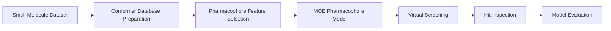

# hERG Pharmacophore Modeling using MOE


This repository presents a **MOE-based pharmacophore modeling workflow** for evaluating potential **hERG inhibitor liability** using small-molecule conformer databases, pharmacophore feature selection, screening, and model-performance interpretation.

The project is organized as a clean computational drug-discovery portfolio example. It focuses on the practical steps used in **Molecular Operating Environment (MOE)** for pharmacophore model construction and virtual screening.

---

## Project Overview

The goal of this workflow is to build and evaluate a pharmacophore model that can identify compounds with potential hERG-related activity patterns.

### Main tasks

- Prepare molecular conformer databases in MOE
- Define and evaluate pharmacophore features
- Screen compounds against the selected pharmacophore model
- Inspect hits from packed and screened conformer databases
- Summarize model-level performance using confusion-matrix metrics

---

## Repository Structure

```text
.
├── models/
│   ├── hERG_pharmacophore_model.ph4
│   └── pharmacophore_features.ph4que
├── moe_databases/
│   ├── conf_log.mdb
│   ├── conf_out.mdb
│   ├── conf_unk.mdb
│   ├── dbname_conf.mdb
│   ├── dbnamescreen_conf.mdb
│   ├── mdr_pharmacophore.mdb
│   ├── packed.mdb
│   ├── ph4_out.mdb
│   ├── ph4_out2.mdb
│   └── screening.mdb
├── results/
│   ├── figures/
│   │   ├── pharmacophore_model_features.png
│   │   ├── packed_conformation_hits.jpg
│   │   └── screening_hits.jpg
│   └── tables/
│       └── model_evaluation_summary.txt
├── docs/
│   ├── methodology.md
│   ├── moe_workflow_notes.md
│   └── limitations.md
├── README.md
├── LICENSE
└── .gitignore
```

---

## Workflow Summary



---

## Selected Pharmacophore Features

The selected model uses three main pharmacophore features:

| Feature | Type | Radius |
|---|---|---:|
| F1 | Donor/Acceptor feature | 1.1 |
| F2 | Hydrophobic feature | 1.3 |
| F3 | Acceptor feature | 1.0 |

---

## Model Evaluation Summary

The recorded model summary contains:

| Metric component | Count |
|---|---:|
| True positives | 6 |
| True negatives | 6 |
| False positives | 0 |
| False negatives | 3 |

Reported model accuracy:

```text
Accuracy = (TP + TN) / (TP + TN + FP + FN)
Accuracy = (6 + 6) / (6 + 6 + 0 + 3)
Accuracy = 80%
```

---

## Key Outputs

| Output | Description |
|---|---|
| `models/hERG_pharmacophore_model.ph4` | Final MOE pharmacophore model file |
| `models/pharmacophore_features.ph4que` | Pharmacophore feature definition/query file |
| `moe_databases/*.mdb` | MOE molecular/conformer database files |
| `results/figures/pharmacophore_model_features.png` | Visual representation of selected pharmacophore features |
| `results/figures/packed_conformation_hits.jpg` | Hit inspection from packed conformers |
| `results/figures/screening_hits.jpg` | Screening output visualization |
| `results/tables/model_evaluation_summary.txt` | Summary of model evaluation metrics |

---

## Tools Used

- **MOE (Molecular Operating Environment)**
- Pharmacophore modeling
- Conformer database generation
- Virtual screening
- hERG liability interpretation
- Cheminformatics workflow organization

---

## Notes

This repository includes MOE-generated project files. Some files require **MOE** to open, inspect, or reproduce the workflow. The repository is intended as a computational drug-discovery portfolio project and a structured reference for pharmacophore modeling workflow organization.

---

## Author

**Hazrat Maghaz**  
Bioinformatician | Computational Biologist | AI Drug Discovery Enthusiast

- Website: https://hazratmaghaz.tech
- GitHub: https://github.com/HazratMaghaz
- LinkedIn: https://www.linkedin.com/in/hazrat-maghaz-6967b9374/

---

## License

This repository is available under the license included in the `LICENSE` file.
